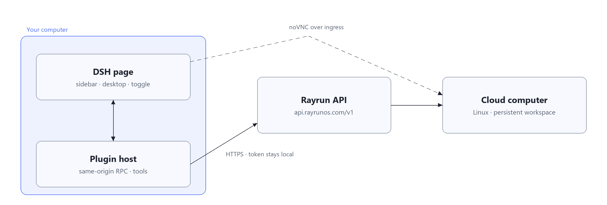

<div align="center">
  
  <h1>dsh-rayrun-computer</h1>
  <p><strong>Rayrun cloud computers, inside DeepSeek Harness.</strong><br>
  A real Linux desktop in your sidebar — and a sandbox the agent can drive.</p>
  <p>
    
    
    <a href="LICENSE"></a>
  </p>
  <p><strong>English</strong> · <a href="README.zh-CN.md">简体中文</a></p>
</div>

How much work can a cheap-enough cloud host do for DeepSeek Harness? That question is why we built this project — to bring **cloud computers** into DSH: create a Linux machine from the sidebar, open its desktop in the page, or let the agent run commands, move files and hand off whole tasks on it. Each machine has its own CPU, memory and a persistent workspace, so the agent can keep working there round after round.

The rule is **local-first**. The cloud is a worker, not a second home: your checkout stays the source of truth, pushes are verified down to the patch SHA-256, and anything pulled back lands in `.dsh/incoming/` for you to read before applying.

## What you get

- **Cloud computers in the sidebar.** Create one with a wizard (image, vCPU, RAM, and a model credential if its agent will call a model), then start, pause, resume, shut down, rename or destroy it. Cards show status, image, spec, IP and machine hours; the header shows balance and total hours.
- **A real desktop, in the page.** Machines created with a remote desktop publish their noVNC port: open it inline, in a new window, or fullscreen. One click reveals the VNC password. Images whose empty `/etc/hosts` breaks `websockify` (the WebSocket closes with 1011) are repaired automatically when the desktop connects.
- **Tools for the agent.** `rayrun_sandbox`, `rayrun_exec`, `rayrun_files`, `rayrun_agent` — plus `rayrun_desktop` for screen-level computer use, and `rayrun_dsh` / `rayrun_workspace` for the cloud worker layer.
- **Cloud or local, per session.** The composer toggle is a real route, not a prompt: in cloud mode the host refuses local `pwsh` / `bash` / `write` / `edit`, so the agent cannot quietly work locally. Read-only tools stay available for review.
- **A worker that matches your DSH.** Push a worker layer into the machine's headless profile and verify it by hash; delegate a whole task with an objective and acceptance criteria; get the results back, round after round.
- **Sync you can check.** `push` ships commits as a git bundle, then dirty and untracked files; the patch digest is recomputed on both sides and compared. `pull` writes the cloud diff into `.dsh/incoming/<timestamp>/` and applies nothing.
- **Login without copy-paste.** Username and password, or WeChat. A token is created for you and stored in the Harness vault, host side only.
- **Optional auto-stop and updates.** Stop idle machines after a task (never destroy), and update the bundle from the page once a new version is published.

## How it fits together



## Quick start

**Requirements**

- **DeepSeek Harness** `0.2.1-rc.5` tested — the desktop app or `dsh web`.
- **A Rayrun account** from [rayrunos.com](https://rayrunos.com/); the plugin creates an API token for you.
- **Chrome or Edge** only for WeChat sign-in; otherwise optional.

The package is **not on npm yet**, so install from a checkout:

```bash
git clone https://github.com/RayrunOS/dsh-rayrun-computer.git
```

1. Add the checkout in **Plugins → Add plugin** (give it the absolute directory), or from a terminal:
   `dsh plugin --profile web add /abs/path/dsh-rayrun-computer`
2. **Restart DSH.** The client half only loads when the page starts.
3. In **Cloud Computer → Connection settings**, sign in with your Rayrun account or paste an API token.
4. **New computer** → image, at least 2 GB of memory, remote desktop on → **Create and open** (about 15 seconds).

The desktop app and `dsh web` use different profiles (`desktop` and `web`), so install into the one you actually open. More install paths and fixes: [installation guide](docs/installation.md).

Sanity check: ask the agent to list your machines. With no token it must answer `token_required`, never pretend the work happened.

## Machines and billing

Machines come from [Rayrun](https://rayrunos.com/) and are billed by the second. The sidebar header shows your balance and total machine hours.

## Tools

| Tool | What it does |
| --- | --- |
| `rayrun_sandbox` | create · list · inspect · start · stop · pause · resume · destroy |
| `rayrun_exec` | run a non-interactive command (`/bin/sh -c` or argv); returns exit code, stdout, stderr |
| `rayrun_desktop` | screenshot the X11 desktop, then click, type, send keys or scroll on it |
| `rayrun_files` | list, upload and download files in the machine's workspace |
| `rayrun_agent` | hand a whole task to the agent inside the machine and wait for the stream |
| `rayrun_dsh` | `sync` the worker layer, `status` compare it, `delegate` a task and wait; `start` + `result` delegate without waiting |
| `rayrun_workspace` | `push` a verified copy of your checkout, `pull` the cloud diff for review |

## Host RPC (detached worker)

A caller that outlives the page — a bot host, for example — can drive the same worker layer over the same-origin RPC route. These actions are available from **`1.1.0`** (accepted range `>=1.1.0 <2.0.0`). POST `/plugins/rayrun/rpc` with a JSON body:

| Action | Input | Returns |
| --- | --- | --- |
| `dsh.start` | `sandbox`, `local_dir`, `objective`, `acceptance`; optional `context`, `constraints`, `decisions`, `open_questions`, `task_id`, `timeout` | immediately: `task_id` |
| `dsh.status` | `sandbox`, `task_id` | `running`, `activity`, `files` |
| `dsh.result` | `sandbox`, `task_id`, `local_dir` | `results_dir`, `files` |

```json
{ "action": "dsh.start", "sandbox": "box", "local_dir": "/abs/bot-workspace",
  "objective": "…", "acceptance": ["…"], "context": "…", "task_id": "task-…", "timeout": 900 }
```

- `sandbox` is required and must already exist (name or id). A missing machine returns `sandbox_missing`; this surface never creates one. `dsh.start` starts or resumes a stopped/paused machine; `dsh.status` and `dsh.result` require it to be running.
- `dsh.start` needs an agent image whose oneshot `[run].argv` launches DSH headless (for example `deepseek-harness@1`). An image whose argv is `/bin/sh -c` (such as the runtime-test images `dsh-bot@1` / `dsh-bot-devcheck@1`) executes the delegation prompt as a shell command, not a DSH turn.
- `local_dir` is an absolute git checkout owned by the caller. `start` mirrors it to the machine and takes the workspace lock; `result` downloads into `<local_dir>/.dsh/results/<task_id>/` and releases the lock once the worker is gone.
- `task_id` names the task; omit it to generate one. A task id this `local_dir` has not seen starts at round 1; an existing one advances to the next round.
- `timeout` is seconds (default 900, max 3600).
- POST only, same-origin checked like every action on this route. Responses never contain the Rayrun token.

Return shapes:

```json
// dsh.start
{ "ok": true, "task_id": "task-…", "sandbox": "box", "machine_id": "sb-…", "round": 1,
  "prompt_id": "…", "started_at": "2026-11-22T…", "results_dir": "/abs/…/.dsh/results/task-…",
  "revs": { "sessionSeq": null, "workspaceRev": "…", "profileRev": "…" }, "resynced": false }

// dsh.status
{ "ok": true, "task_id": "task-…", "sandbox": "box", "machine_id": "sb-…",
  "running": true, "activity": "2026-11-22 10:00:00…", "files": ["decision.txt"],
  "lock": { "key": "sb-…", "holder": "delegate task-…", "reason": "task-…", "since": 0, "expiresAt": 0 } }

// dsh.result
{ "ok": true, "task_id": "task-…", "sandbox": "box", "machine_id": "sb-…",
  "running": false, "activity": "…", "results_dir": "/abs/…/.dsh/results/task-…",
  "files": ["decision.txt"], "released": true, "questions": "" }
```

`status.lock` is `null` when this Host process holds no lock for the machine (for example after a Host restart). Failures use the route's usual shape: `{ "ok": false, "error": { "code", "message", "status" } }`. Stable codes include `origin_mismatch`, `token_required`, `sandbox_required`, `sandbox_missing`, `local_dir_required`, `local_dir_not_absolute`, `local_dir_missing`, `brief_incomplete`, `invalid_timeout`, `invalid_task_id`, `workspace_locked`, `workspace_drift`, `workspace_not_mirrored` and `projection_not_applied`.

`dsh.status.files` lists what exists in the cloud result directory; `dsh.result.files` lists what was downloaded into `results_dir`.

### Runtime RPC

A host that must keep a process alive inside the machine can declare platform runtimes (ADR-036) through the same route. Available from **`1.2.0`**.

| Action | Input | Returns |
| --- | --- | --- |
| `runtime.put` | `sandbox`, `name`, `spec` | read-back `runtime`, `applied`, `restarted` |
| `runtime.list` | `sandbox` | `runtimes` |
| `runtime.get` | `sandbox`, `name` | `runtime` or `null` |
| `runtime.start` / `runtime.stop` / `runtime.restart` | `sandbox`, `name` | read-back `runtime` |
| `runtime.delete` | `sandbox`, `name` | `deleted: true` (idempotent) |

`spec`: `argv` (required), `workdir`, `env`, `credentials`, `restart` (`no` / `on-failure` / `always`), `autostart`, `keep_alive`, `stop_signal` (`SIGTERM` / `SIGINT` / `SIGKILL`), `stop_timeout_seconds` (0–30).

- `sandbox` must already exist and is never created or woken. `runtime.put` on a paused/stopped machine persists the spec and reports `applied: false`; actions return `sandbox_paused` (503) or `sandbox_not_running` (409).
- `credentials` is a list of **binding names already attached to the sandbox**, never values. The adapter does not read or print the Rayrun token; credential values are injected by the platform only at sandbox boot, so a runtime restart does not refresh them.
- The binding names attached to a machine are returned by `overview` (each `machines[]` entry) and `machine.get` as `machine.credentials`; a runtime spec without explicit `credentials` should use these names.
- `keep_alive: true` keeps the platform idle sweeper away. The plugin's own optional `idle_stop_minutes` is separate — disable it for a persistent bot host.
- Old images (guestd < 0.6.0) return `guestd_outdated` on writes/actions. `runtime.list` and `runtime.get` still return persisted specs with `state: "unknown"` and `status_error: "guestd_outdated"`.
- The platform runtimes API is not on the hosted production API as of 2026-11-22; a deployment without the route returns `runtimes_unavailable` (plain 404). Deploy the daemon and a guestd 0.6.0 image before relying on it.

Return shapes:

```json
// runtime.put
{ "ok": true, "sandbox": "box", "machine_id": "sb-…", "runtime": { … },
  "applied": true, "restarted": false }

// runtime.list
{ "ok": true, "sandbox": "box", "machine_id": "sb-…", "runtimes": [ { … } ] }

// runtime.get
{ "ok": true, "sandbox": "box", "machine_id": "sb-…", "runtime": { … } }

// runtime.start / stop / restart
{ "ok": true, "sandbox": "box", "machine_id": "sb-…", "runtime": { … } }

// runtime.delete
{ "ok": true, "sandbox": "box", "machine_id": "sb-…", "name": "bot-host", "deleted": true }
```

`runtime.get.runtime` is `null` when the name is absent. A runtime view is the platform's spec + live state:

```json
{ "name": "bot-host",
  "spec": { "name": "bot-host", "argv": ["…"], "workdir": "/workspace",
            "env": { "MODE": "bot" }, "credentials": ["model-key"],
            "restart": "always", "autostart": true, "keep_alive": true,
            "stop_signal": "SIGTERM", "stop_timeout_seconds": 10 },
  "state": "running", "pid": 1234, "restarts": 0 }
```

Runtime errors add `invalid_runtime_name`, `invalid_runtime_spec`, `runtime_not_found` and `runtimes_unavailable`, while `guestd_outdated`, `sandbox_not_running`, `sandbox_paused`, `invalid_request`, `resource_exhausted`, `runtime_sync_failed`, `service_unavailable`, `not_found` and `illegal_state` pass through from the platform.

## Configuration

Bundle defaults live in `cordis.patch.yml`; override only what you need in your profile:

```yaml
# $DSH_HOME/profiles/<profile>/cordis.patch.yml
- id: rayrun-cloud
  name: 'dsh-rayrun-computer'
  config:
    sandboxName: dsh-workspace
    idle_stop_minutes: 15    # stop idle machines; never destroys
    egress_allow:            # machines start with no outbound network
      - api.deepseek.com
```

Every key is documented in the [usage manual](docs/usage.md#配置项); the token lookup order is [here](docs/usage.md#token-与-api-地址).

## Docs

The detailed docs are in Chinese for now.

| Read | For |
| --- | --- |
| [Installation](docs/installation.md) | every install path, first connection, troubleshooting |
| [Usage manual](docs/usage.md) | desktops, cloud/local routing, worker layer, workspace sync, delegation, auto-stop, full config and tool reference |
| [Parity design](docs/cloud-dsh-parity-plan.md) | why the cloud worker layer exists, what syncs and what does not |
| [Development](docs/development.md) | module map, checks, tests, live integration |

## Security and caveats

- **The token stays on the host.** The page talks to `/plugins/rayrun/rpc` (same-origin, checked) and never receives it; passwords live in memory only.
- **`destroy` is irreversible** — the machine and its workspace are deleted together.
- **No outbound network by default.** A new machine cannot reach anything until you list hosts in `egress_allow`.
- **The cloud image is already root.** It ships without bubblewrap, so the worker layer sets `danger-full-access` to make shells work. That is a workaround, not isolation.
- **A bundle's host code runs inside the DSH process.** Install it from a source you trust.

## Development

```bash
node --check index.js
node --check client.js
node test/security.mjs
node test/tool-routing.mjs
node test/desktop.mjs
node test/dsh-rpc.mjs
```

No build step and no runtime dependencies; `client.js` only loads modules DSH provides. CI runs the same checks on Node 22 and 24 (`.github/workflows/ci.yml`), and npm publishing waits for it. Full check and test matrix: [docs/development.md](docs/development.md).

## License

MIT © RayrunOS — see [LICENSE](LICENSE).
