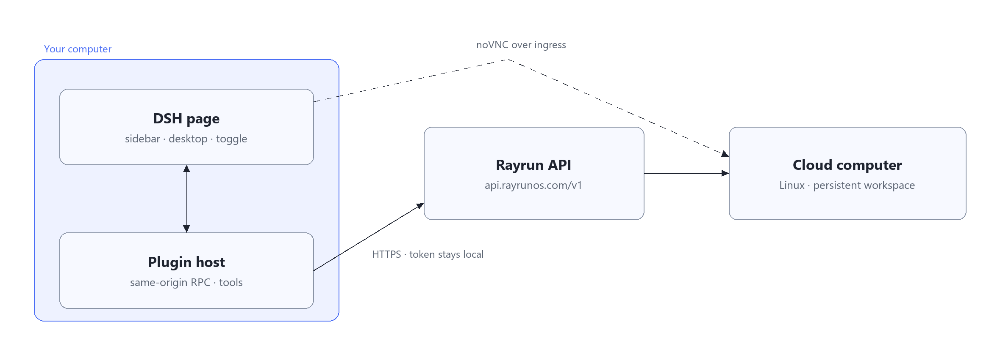

<div align="center">
  
  <h1>dsh-rayrun-computer</h1>
  <p><strong>Rayrun cloud computers, inside DeepSeek Harness.</strong><br>
  A real Linux desktop in your sidebar — and a sandbox the agent can drive.</p>
  <p>
    
    
    <a href="LICENSE"></a>
  </p>
  <p><strong>English</strong> · <a href="README.zh-CN.md">简体中文</a></p>
</div>

How much work can a cheap-enough cloud host do for DeepSeek Harness? That question is why we built this project — to bring **cloud computers** into DSH: create a Linux machine from the sidebar, open its desktop in the page, or let the agent run commands, move files and hand off whole tasks on it. Each machine has its own CPU, memory and a persistent workspace, so the agent can keep working there round after round.

The rule is **local-first**. The cloud is a worker, not a second home: your checkout stays the source of truth, pushes are verified down to the patch SHA-256, and anything pulled back lands in `.dsh/incoming/` for you to read before applying.

## What you get

- **Cloud computers in the sidebar.** Create one with a wizard (image, vCPU, RAM, and a model credential if its agent will call a model), then start, pause, resume, shut down, rename or destroy it. Cards show status, image, spec, IP and machine hours; the header shows balance and total hours.
- **A real desktop, in the page.** Machines created with a remote desktop publish their noVNC port: open it inline, in a new window, or fullscreen. One click reveals the VNC password. Images whose empty `/etc/hosts` breaks `websockify` (the WebSocket closes with 1011) are repaired automatically when the desktop connects.
- **Tools for the agent.** `rayrun_sandbox`, `rayrun_exec`, `rayrun_files`, `rayrun_agent` — plus `rayrun_desktop` for screen-level computer use, and `rayrun_dsh` / `rayrun_workspace` for the cloud worker layer.
- **Cloud or local, per session.** The composer toggle is a real route, not a prompt: in cloud mode the host refuses local `pwsh` / `bash` / `write` / `edit`, so the agent cannot quietly work locally. Read-only tools stay available for review.
- **A worker that matches your DSH.** Push a worker layer into the machine's headless profile and verify it by hash; delegate a whole task with an objective and acceptance criteria; get the results back, round after round.
- **Sync you can check.** `push` ships commits as a git bundle, then dirty and untracked files; the patch digest is recomputed on both sides and compared. `pull` writes the cloud diff into `.dsh/incoming/<timestamp>/` and applies nothing.
- **Login without copy-paste.** Username and password, or WeChat. A token is created for you and stored in the Harness vault, host side only.
- **Optional auto-stop and updates.** Stop idle machines after a task (never destroy), and update the bundle from the page once a new version is published.

## How it fits together



## Quick start

**Requirements**

- **DeepSeek Harness** `0.2.1-rc.5` tested — the desktop app or `dsh web`.
- **A Rayrun account** from [rayrunos.com](https://rayrunos.com/); the plugin creates an API token for you.
- **Chrome or Edge** only for WeChat sign-in; otherwise optional.

The package is **not on npm yet**, so install from a checkout:

```bash
git clone https://github.com/RayrunOS/dsh-rayrun-computer.git
```

1. Add the checkout in **Plugins → Add plugin** (give it the absolute directory), or from a terminal:
   `dsh plugin --profile web add /abs/path/dsh-rayrun-computer`
2. **Restart DSH.** The client half only loads when the page starts.
3. In **Cloud Computer → Connection settings**, sign in with your Rayrun account or paste an API token.
4. **New computer** → image, at least 2 GB of memory, remote desktop on → **Create and open** (about 15 seconds).

The desktop app and `dsh web` use different profiles (`desktop` and `web`), so install into the one you actually open. More install paths and fixes: [installation guide](docs/installation.md).

Sanity check: ask the agent to list your machines. With no token it must answer `token_required`, never pretend the work happened.

## Machines and billing

Machines come from [Rayrun](https://rayrunos.com/) and are billed by the second. The sidebar header shows your balance and total machine hours.

## Tools

| Tool | What it does |
| --- | --- |
| `rayrun_sandbox` | create · list · inspect · start · stop · pause · resume · destroy |
| `rayrun_exec` | run a non-interactive command (`/bin/sh -c` or argv); returns exit code, stdout, stderr |
| `rayrun_desktop` | screenshot the X11 desktop, then click, type, send keys or scroll on it |
| `rayrun_files` | list, upload and download files in the machine's workspace |
| `rayrun_agent` | hand a whole task to the agent inside the machine and wait for the stream |
| `rayrun_dsh` | `sync` the worker layer, `status` compare it, `delegate` a task and wait; `start` + `result` delegate without waiting |
| `rayrun_workspace` | `push` a verified copy of your checkout, `pull` the cloud diff for review |

## Configuration

Bundle defaults live in `cordis.patch.yml`; override only what you need in your profile:

```yaml
# $DSH_HOME/profiles/<profile>/cordis.patch.yml
- id: rayrun-cloud
  name: 'dsh-rayrun-computer'
  config:
    sandboxName: dsh-workspace
    idle_stop_minutes: 15    # stop idle machines; never destroys
    egress_allow:            # machines start with no outbound network
      - api.deepseek.com
```

Every key is documented in the [usage manual](docs/usage.md#配置项); the token lookup order is [here](docs/usage.md#token-与-api-地址).

## Docs

The detailed docs are in Chinese for now.

| Read | For |
| --- | --- |
| [Installation](docs/installation.md) | every install path, first connection, troubleshooting |
| [Usage manual](docs/usage.md) | desktops, cloud/local routing, worker layer, workspace sync, delegation, auto-stop, full config and tool reference |
| [Parity design](docs/cloud-dsh-parity-plan.md) | why the cloud worker layer exists, what syncs and what does not |
| [Development](docs/development.md) | module map, checks, tests, live integration |

## Security and caveats

- **The token stays on the host.** The page talks to `/plugins/rayrun/rpc` (same-origin, checked) and never receives it; passwords live in memory only.
- **`destroy` is irreversible** — the machine and its workspace are deleted together.
- **No outbound network by default.** A new machine cannot reach anything until you list hosts in `egress_allow`.
- **The cloud image is already root.** It ships without bubblewrap, so the worker layer sets `danger-full-access` to make shells work. That is a workaround, not isolation.
- **A bundle's host code runs inside the DSH process.** Install it from a source you trust.

## Development

```bash
node --check index.js
node --check client.js
node test/security.mjs
node test/tool-routing.mjs
node test/desktop.mjs
```

No build step and no runtime dependencies; `client.js` only loads modules DSH provides. Full check and test matrix: [docs/development.md](docs/development.md).

## License

MIT © RayrunOS — see [LICENSE](LICENSE).
