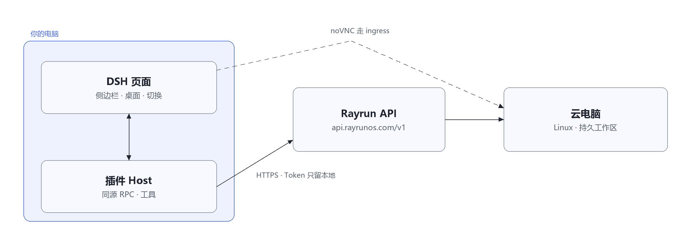

<div align="center">
  
  <h1>dsh-rayrun-computer</h1>
  <p><strong>DSH 里的 Rayrun 云电脑。</strong><br>
  侧边栏就能打开的 Linux 桌面，也是模型能直接驱动的沙箱。</p>
  <p>
    
    
    <a href="LICENSE"></a>
  </p>
  <p><a href="README.md">English</a> · <strong>简体中文</strong></p>
</div>

给 DeepSeek Harness 一台足够便宜的云主机，可以帮助我们干多少活呢？带着这么一个疑问，我们创建了这个项目——把**云电脑**接进 DSH：在侧边栏创建 Linux 机器，在页面里打开远程桌面，或者直接让模型在上面跑命令、传文件、委托整段任务。每台机器有独立的 CPU、内存和持久化工作区，模型可以在上面一轮接一轮地做下去。

原则是**本地优先**。云上只是 worker，不是第二个家：你的 checkout 是唯一事实来源，推送会校验到 patch 的 SHA-256，拉回的改动先落在 `.dsh/incoming/` 等你审阅，再决定要不要应用。

## 有什么

- **侧边栏里的云电脑。** 选镜像、vCPU、内存（以及给机器内 agent 用的模型凭证）创建，之后开机、暂停、恢复、关机、重命名、销毁。卡片展示状态、镜像、规格、IP 和机时，顶部显示余额和累计机时。
- **页面里的真桌面。** 创建时开启远程桌面的机器会发布 noVNC 端口，可以内嵌打开、新窗口打开或全屏；桌面密码一键取。镜像里空 `/etc/hosts` 导致 `websockify` 解析失败（WebSocket 以 1011 关闭）的问题，会在连接桌面时自动修好。
- **给模型用的工具。** `rayrun_sandbox`、`rayrun_exec`、`rayrun_files`、`rayrun_agent`、桌面 computer use 的 `rayrun_desktop`，以及云上 worker 的 `rayrun_dsh` 和 `rayrun_workspace`。
- **按会话切换云上 / 本地。** 输入区的切换是**真路由**，不是提示词：云上模式下 Host 直接拒绝本地 `pwsh` / `bash` / `write` / `edit`，模型没法偷偷在本地干活；只读工具仍然可用，用来审阅和汇总。
- **和本地一致的 worker。** 往机器的 headless profile 推一层 worker 图层，用哈希校验它真的生效；把整段任务连同目标和验收标准委托过去，拿回结果，支持多轮。
- **可核对的工作区同步。** `push` 用 git bundle 带走提交，再带脏改动和未跟踪文件，两边各自重算 patch 的 SHA-256；`pull` 只把云端 diff 写进 `.dsh/incoming/<时间戳>/`，不会自动应用。
- **不用手动复制 Token。** 账号密码或微信登录，登录后自动创建 Token 并存入 Harness 凭证库，只存在 Host 侧。
- **可选的自动停机与更新。** 任务结束后空闲多久自动关机（永不销毁），以及页面里的一键更新。

## 架构



## 快速开始

**要求**

- **DeepSeek Harness** 在 `0.2.1-rc.5` 上验证过 — 桌面应用或 `dsh web`。
- **一个 Rayrun 账号**，来自 [rayrunos.com](https://rayrunos.com/)；Token 由插件自动创建。
- **Chrome / Edge** 只有微信登录需要；其他情况可选。

这个包**还没有发布到 npm**，从 checkout 安装：

```bash
git clone https://github.com/RayrunOS/dsh-rayrun-computer.git
```

1. 在 **插件 → 添加插件** 里填这个 checkout 的绝对路径；或者在终端执行
   `dsh plugin --profile web add /abs/path/dsh-rayrun-computer`
2. **重启 DSH。** Client 半区只在页面启动时加载。
3. 打开 **云电脑 → 连接设置**，用 Rayrun 账号登录，或粘贴已有的 API Token。
4. **新建云电脑** → 选镜像、内存至少 2 GB、开启远程桌面 → **创建并打开**（约 15 秒）。

桌面应用和 `dsh web` 用的是两个 profile（`desktop` 和 `web`），装到你实际会打开的那一个。更多安装方式和排障见[安装指南](docs/installation.md)。

自检：让模型列一下你的机器。没配 Token 时它必须报 `token_required`，而不是说「已完成」。

## 机器与计费

机器来自 [Rayrun](https://rayrunos.com/)，按秒计费。侧边栏顶部显示账户余额和累计机时。

## 工具

| 工具 | 作用 |
| --- | --- |
| `rayrun_sandbox` | create · list · inspect · start · stop · pause · resume · destroy |
| `rayrun_exec` | 执行非交互命令（`/bin/sh -c` 或 argv），返回 exit code、stdout、stderr |
| `rayrun_desktop` | 截取桌面，并在上面点击、键入、按键、滚动（X11 / xdotool） |
| `rayrun_files` | 列目录、上传、下载机器工作区里的文件 |
| `rayrun_agent` | 把整段任务交给机器内的 agent，流式等待结果 |
| `rayrun_dsh` | `sync` 推送并校验 worker 图层，`status` 只读比对，`delegate` 委托任务；`start` + `result` 不等待地委托与收取 |
| `rayrun_workspace` | `push` 推送并校验 checkout，`pull` 回传云端 diff 供审阅 |

## 配置

bundle 的默认值在 `cordis.patch.yml`；只覆盖你要改的键：

```yaml
# $DSH_HOME/profiles/<profile>/cordis.patch.yml
- id: rayrun-cloud
  name: 'dsh-rayrun-computer'
  config:
    sandboxName: dsh-workspace
    idle_stop_minutes: 15    # 空闲后自动关机，永不销毁
    egress_allow:            # 新机器默认没有出向网络
      - api.deepseek.com
```

完整的配置项见[使用手册](docs/usage.md#配置项)，Token 解析顺序见[这里](docs/usage.md#token-与-api-地址)。

## 文档

| 文档 | 内容 |
| --- | --- |
| [安装指南](docs/installation.md) | 各种安装方式、第一次连接、常见问题 |
| [使用手册](docs/usage.md) | 远程桌面、云上/本地切换、worker 图层、工作区同步、委托、自动停机、完整配置与工具参考 |
| [一致性方案](docs/cloud-dsh-parity-plan.md) | 为什么要有云上 worker 图层，什么同步、什么不同步 |
| [开发与自测](docs/development.md) | 模块地图、检查与测试命令、联调 |

## 安全边界

- **Token 只存在 Host 侧。** 页面通过同源的 `/plugins/rayrun/rpc` 调用（校验 `Origin`），拿不到 Token；密码只存在内存。
- **`destroy` 不可恢复**——机器和工作区数据一起删除。
- **新建机器默认没有出向网络。** 装包或调外部 API 之前，得先在 `egress_allow` 里列出来。
- **云上镜子里本来就是 root。** 镜像没有 bubblewrap，worker 图层只能覆盖成 `danger-full-access` 让 shell 可用；这是绕路，不是隔离。
- **bundle 的 Host 代码跑在 DSH 进程里。** 只从你信任的来源安装。

## 开发

```bash
node --check index.js
node --check client.js
node test/security.mjs
node test/tool-routing.mjs
node test/desktop.mjs
```

没有构建步骤，也没有运行时依赖；`client.js` 只用 DSH 提供的内建模块。完整的检查与测试清单见[开发与自测](docs/development.md)。

## License

MIT © RayrunOS — 见 [LICENSE](LICENSE)。
